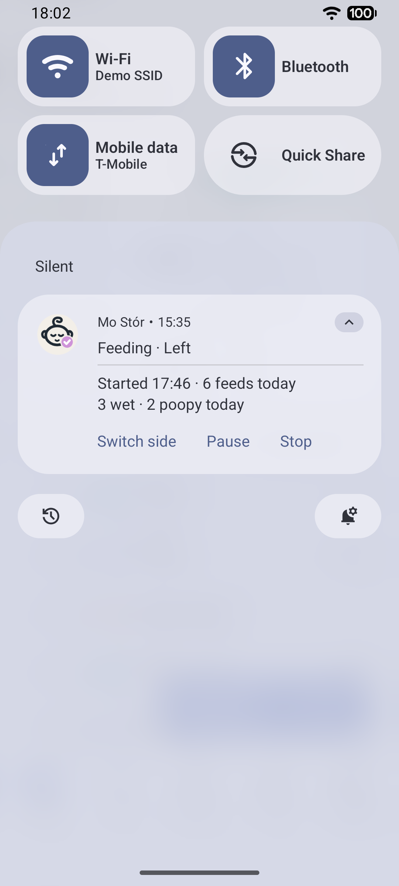
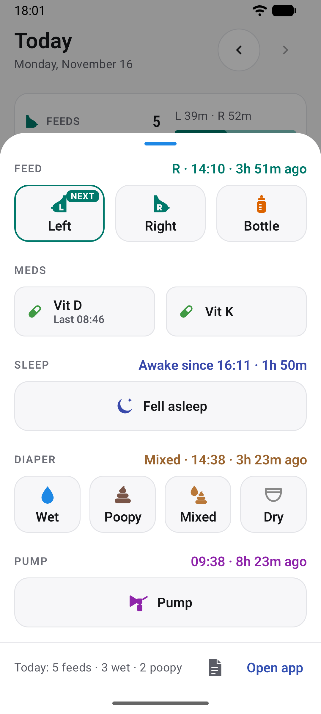
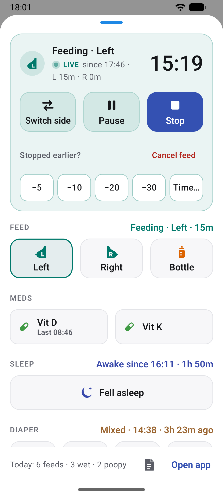
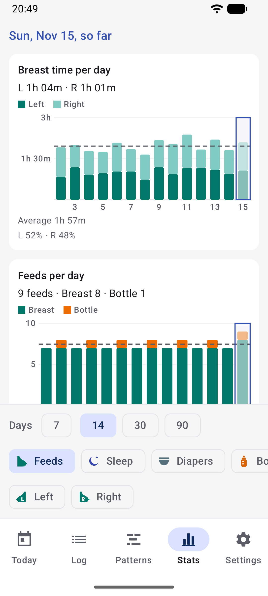

<h1>Mo Stór
</h1>

<i>[mə ˈstoːr] · Irish: “My Treasure”</i>    
A local baby log you use from the notification, even on the lock screen.

<br clear="right">


Mo Stór is an Android baby log for one-hand use at 3am. The core proposition is a 2-tap recording of any metric you need, straight from a notification on a locked screen: feeding, meds, sleep, diaper change, or pumping.  
Thus, the app's notification is intended to be the primary interface:  
- Swipe: Pull down the shade to show notifications.   
- Tap 1: Tap the Mo Stór notification.  
- Tap 2: Tap a button to record an event or start/stop a timer.   

No screen unlock is required.  
No account and no setup: open it once, allow notifications, and start recording.  

<p>
  
  
  
  
</p>

## Features

- **Records all key metrics**   
Breastfeeds (with side switches), bottles, pumping, sleep, diapers, meds and supplements (with an optional daily or weekly schedule), and notes.
- **The notification answers all pressing questions**  
Time since the last feed started, the last side, asleep or awake and for how long, today's diaper counts.
- **Fixes timing mistakes in one more tap**   
Event that started 10 min ago or ended 20 min ago; a timer
  that ran for hours is automatically caught and easy to correct later.
- **Undo or correct any record at any time**   
Every record can be undone right away and edited at any time.
- **Customizable UI**  
Only see what you want to record, per device.
- **Today, Log, Patterns, and Stats**   
The day as a timeline, every record with filters and editing, one row per day across the 24 hours to see rhythms, and per-day charts.
- **Support for multiple children**  
Each child comes with their own metadata and meds schedule.
- **Sync between caregivers' phones over Bluetooth**   
Directly between the phones, encrypted with a key only they share.
- **Backups, Export, and Import**    
A full database copy, JSON and CSV export, JSON import, and an optional daily export to a folder you choose. A PDF daily report of the Baby Tracker app can be imported.

## Privacy

- The app has **no Internet permission**. A check in the build fails if any library adds one,
  or any other permission that isn't on a short allowlist.
- No account, ads, analytics or crash reporting.
- The release permissions are:  
  - notifications
  - starting after a reboot (to bring the notification back)
  - Bluetooth: scan, connect, and advertise for sync.  
    The scan permission is explicitly declared as `neverForLocation`.

To check a downloaded APK yourself:

```
apkanalyzer manifest permissions app-prod-release.apk
```

## Install

Mo Stór needs **Android 12** or later.

Download the APK from [Releases](../../releases) and open it on the phone. Releases are signed
with this certificate (SHA-256):

```
8c:cd:3e:af:d0:69:c7:94:53:1e:37:3d:3f:33:2f:ff:8a:77:c1:2d:6f:01:0e:18:e5:6b:a7:f6:c4:86:6b:32
```

To check it: `apksigner verify --print-certs app-prod-release.apk`.

Uninstalling Mo Stór deletes its data. Export a backup first (Settings › Backup and import).

## Build

You need JDK 17 or later and the Android SDK (Android Studio brings both).

```
# debug build: id io.github.uirlisi.mostor.dev, "Mo Stór dev"
./gradlew assembleDevDebug              
./gradlew :core:test testDevDebugUnitTest
```

On Windows, use `.\gradlew.bat`.

There are two flavors, which install side by side:

- **dev** (`io.github.uirlisi.mostor.dev`) for development, with its own database.
- **prod** (`io.github.uirlisi.mostor`), the production version of the app. It does not have a debug build.

A signed prod release needs the release key, configured in `local.properties` (never committed):

```
mostor.keystore.path=C:/path/to/release.jks
mostor.keystore.password=...
mostor.key.alias=...
mostor.key.password=...
```

Without the key, build it unsigned:

```
./gradlew assembleProdRelease -Pmostor.unsigned=true
```

Release builds are reproducible: the same source gives the same APK, apart from the signature.

### Layout

```
core/   pure Kotlin, no Android: domain model, days and durations, stats, hybrid logical
        clock, merge, sync protocol. Unit tests with JUnit 5 and jqwik.
app/    Android: Room database and migrations, the notification and quick sheet, screens,
        backup and export, Bluetooth sync. Room tests run under Robolectric.
```

Kotlin, Jetpack Compose with Material 3, Room, coroutines. Charts are drawn with Compose
`Canvas`. No other dependencies.

## License

Copyright © 2026 uirlisi

Mo Stór is free software: you can redistribute it and/or modify it under the terms of the GNU
General Public License as published by the Free Software Foundation, either version 3 of the
License, or (at your option) any later version.   
See [LICENSE](LICENSE).

Libraries: Kotlin, kotlinx.coroutines, AndroidX and Jetpack Compose, and Material Icons, all
under the Apache License 2.0.
